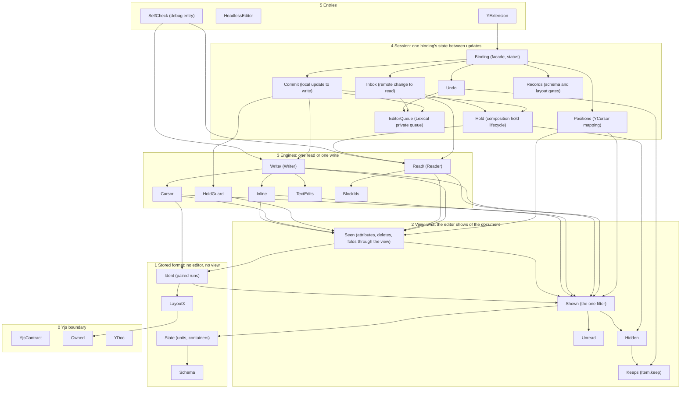

# `@lexical/y` internals: target architecture

This is the module plan for `src/internal/`, written against main
`e2836f099` (line numbers are that commit's, and approximate). It says
what each module is for, what it may import, which state it owns, and the
order in which the three large files are taken apart. Every step is a
refactor under the package rule: identical stored bytes, editor states and
warnings, before and after (section 6 says how that is checked).

Step 1 is done: the shown-items filter (`Shown.ts`). Step 2, the one owner
of `Item.keep` (`Keeps.ts`), is the next pull request. The rest is
planned.

## 1. The problem this solves

The binding has one hard idea: the editor does not always show what the
document stores. Three mechanisms make them differ.

| Mechanism | Since | What differs | Input |
| --- | --- | --- | --- |
| Unread | D108 | A remote change Yjs applied and the binding has not read: what it inserted is not shown, what it deleted still is. | `View` (`Unread.ts`) |
| Held | the composition hold | A collaborator's change to the line being composed: what it inserted is not shown (by id range, so an item can be held in part), a format item it deleted still is (kept). | `Hidden` (`Hidden.ts`) |
| Left out | D116 | A stored inline element that holds no content, which no reader makes a node for. | `LeftOut` (a predicate over the editor state) |

Before step 1, each reader, writer and cursor combined these by hand:
`isGoneIn(view, x) || this.isHeldFormat(x)` in the cursor,
`isGoneIn(view, it) && (hidden === null || !hidden.keeps(it))` in the
writer's atoms, `hidden.keeps(p) || change.deleteSet.hasId(p.id)` in the
reader. A fix added a condition to one of them and the next review found
it missing from another. It kept happening while step 1 was in review: a
fix that landed on main in between (#9872) added
`isGoneIn(view, it) || !it.countable || isHeld(it, hidden)` to the reader,
which is the lane `isHiddenIn` written out; the guard of step 1 now fails
on a condition like it. The same shape repeats one level up: `Binding.ts`
is one class of 9,300 lines that owns every piece of state between
updates, so nothing says which code may change which field.

The plan has one rule: **each fact has one owner, and everything else
asks it.**

## 2. Layers

Imports point down only. A module imports from its own layer or a lower
one.



`Ident --> Shown` is the one edge in the diagram that points up, and it is
small: a fold of paired runs must skip an end that is gone or held, and
asks the filter (`isGoneIn`, `isHiddenIn`). Before step 1 this was a cycle
(`Ident` imported `Seen`, `Seen` imported `Ident`); it is now a line. It
goes when the fold takes that question as an argument (`FoldIn` already
carries the view and the hold), with step 3.

The diagram is the target. Today's imports differ from it in seven more
places, none of which needs a step of its own:

- Four are for a type only. `State` and `Hidden` import `Formats` from
  `Cursor`, `State` imports the type `Hidden`, and `Ident` imports `View`
  from `Unread` (for `FoldIn`). Each goes when the type moves down to the
  layer that first names it.
- `State` makes its `BlockIdIndex`, a class of `BlockIds`, which imports
  `State`'s types back: a two-module cycle. It goes when the index moves
  to `State` or is handed to it.
- `YDoc` installs `Ident`'s copy repair (`installCopyRepair`), and
  `Binding` calls the write self-check in `SelfCheck`, which the diagram
  shows as an entry. The first goes when the repair is registered by the
  caller of `createYDoc`'s internals; the second when the check is handed
  to `Commit` as a port.

## 3. Modules

### Layer 2: the view

| Module | Responsibility | Owns | Status |
| --- | --- | --- | --- |
| `Unread.ts` | The record of remote changes not read yet, and which types it applies to (`scopedView`). | Nothing live: `Unread` objects are made and dropped by `Inbox`. | Exists |
| `Hidden.ts` | The record of one hold: held id ranges, kept format items, the held marker attributes. | Nothing live: the `Hidden` object is made by the reader and dropped by `Hold`. | Exists; its `Item.keep` writes move to `Keeps` with step 2 |
| `Keeps.ts` | Every write of Yjs's `Item.keep`. Two clients: the undo registry (D88, `UndoKeeps`) and the hold's kept items (`keepShown`, `unkeepShown`). Each keeps its rule from before the move; a test fails if another module writes the flag. | `Item.keep` | Step 2 |
| **`Shown.ts`** | **Whether an item is shown, and if not, why.** One private function, `facts()`, decides; `whyNotShown()` names the reason; the lanes are the same facts asked with some inputs left out. Also the left-out rule itself (`$isLeftOutInline`), the lengths every position counts by (`shownLengthIn`, `countShown`) and the walk to the shown end before an item (`prevShownEnd`). | The definition of the view. No state. | **Done** |
| `Seen.ts` | Reading and writing through the view: attribute values, deletes that an unread change already made, the delete guard, folds of format items in a lane, the end before a unit. | The per-transaction "noted as deleted" set and the delete guard's protected set. | Exists; shrunk by step 1 |

The filter's contract, which the pin test (`ShownFilter.test.ts`) holds:

- An item is not shown for exactly one reason, in this order: `unread`,
  `deleted`, `held`, `left-out`. A kept item is shown though deleted. An
  item held in part is shown; `heldRuns` gives the part.
- A lane is a named question on the same facts. The list is closed and is
  the table at the top of `Shown.ts`. A new lane is a change to that table
  and to the test.
- `facts()` and the masks that say which facts to look up are private to
  `Shown.ts`: a mask that names a fact and not one it depends on (left out,
  without gone) would answer wrongly, so no caller composes one. `factsOf`
  returns every fact, all looked up.
- No other module asks the hold (`Hidden#hides`, `#keeps`, `#overlaps`,
  `#runs`), the unread changes (`inserted`, `deleted`, a view's `removed`
  and `keeps`) or a left-out predicate, and no condition outside `Shown.ts`
  joins the answers of two lanes: a question the lanes do not answer
  becomes a lane (`isHeldFormatIn` and `wasShownBefore` were conditions of
  the cursor and the reader). A test holds both rules by reading the
  sources with the TypeScript compiler (`utils/shownGuard.ts`): it resolves
  each name to its declaration, so an alias, a destructuring, a line break,
  a comment, a type that only looks like the hold's or a local function
  that wraps a lane neither hides a use nor makes one. Its exceptions are
  a list in the test, each with its reason: four uses that do not decide
  whether a sequence item is shown, and three conditions of the format
  cursor. It does not see two lanes asked in separate statements.

### Layer 3: engines

An engine does one read or one write and keeps no state between them
(what it needs between updates lives in `State`).

| Module | Responsibility | Target shape |
| --- | --- | --- |
| `Cursor.ts` | Item-level writing: insert, delete and format at a position, with paired runs. | Unchanged. It loses `formatPlain` if flat NodeState formats come to be stored as paired runs too: there are two format mechanisms today (paired runs with an opener and an end, and plain values that last until the next one), each with its own fold, and the plain one needs scan bounds the paired one does not. |
| `Inline.ts` | Inline content as atoms, from the editor and from the document, and their diff. | Unchanged. |
| `TextEdits.ts` | Character identity from Lexical's recorded edits (D28). | Unchanged. |
| `Read.ts` (4,523 lines) | `Reader`: remote changes into editor nodes. | Split into `Read/Units.ts` (which units a change touches, cached starts, cascades), `Read/Lines.ts` (a line's inline content into nodes, reuse by piece), `Read/Groups.ts` (lists from `g`, `l`, `o`), `Read/HoldIntake.ts` (`$hold`, `runInLine`, `shownBefore`, `$ownedChanges`: what a change to the composed line holds back). |
| `Write.ts` (7,396 lines) | `Writer`: one editor update into one Yjs transaction. | Split into `Write/Plan.ts` (`$plan`, dirty sets), `Write/Structure.ts` (units matched by key, `$writeStructure`, `$writeSegment`), `Write/Seq.ts` (`$writeSeq`, `$writeHunks`, the format pass), `Write/Markers.ts` (`$writeMarker`, D118), `Write/Origins.ts` (`originOf` and the merge and split heuristics: how the writer guesses which stored characters a text node's characters are when Lexical recorded no edit for them), `Write/Release.ts` (`$writeSkippedLine`, `$writeAgreedLine`, `keepMadeAsStored`: what is written when a hold ends, D115), `Write/FollowUp.ts`. |
| `HoldGuard.ts`, `InsertionFree.ts` | Whether a local write is safe under a hold. | Unchanged. |
| `BlockIds.ts`, `Groups.ts`, `Slots.ts` | Block ids, derived group fields, named slots. | Unchanged. |

`Write/Origins.ts` and `Write/Release.ts` are split out first and on
purpose, because each is the code of a rule that has a simpler candidate,
and a file that can be deleted whole is the cheapest deletion:

- Origins. Character identity has two sources today: Lexical's recorded
  edits (D28) and, where there are none, heuristics over the nodes'
  origins when nodes merge and split. The candidate is one source: the
  recorded edits, else a rewrite of the line by its common prefix and
  suffix. D54 already accepts the race this leaves for text with no
  recorded edit.
- Release. When a hold ends, the writer compares what the editor made
  with what is stored and writes only where they disagree, keeping what
  the editor made "as stored" where they agree. The candidate is to read
  the line again as stored and run the app's transforms on it as a local
  edit. That is a behavior change with its own decision row; it is not
  part of this plan.

### Layer 4: the session

`YBinding` today has about 100 fields. They fall into seven groups, and
each group becomes a module that owns its fields and offers methods. The
binding keeps the public API and the status.

| Module | From `Binding.ts` | Responsibility | Owns |
| --- | --- | --- | --- |
| `Binding.ts` | `1215-1500`, `1727-1860`, `2496-2700`, `3802-4003` | Public API, start and dispose, status and its seven read-only causes, warning delivery. | `_status`, the read-only causes, the warning queue, `disposers` |
| `Records.ts` | `885-1110`, `3018-3800` | Layout, schema and pin records on the root: read, write, gate. | Pins, schema grace |
| `Inbox.ts` | `4133-5230`, `5728-5810` | A remote transaction from Yjs to a read: note, defer, read, recover. | `unread`, `deferred`, `reading`, `deferredView`; it makes the view (`seer`) |
| `Hold.ts` | `1586-1640`, `4886-5023`, `5810-6130` | The hold's lifecycle: start, whether it still holds, release, the held view. One object, one `reset()`. | `state.hidden`, `held`, `heldResult`, `releasing`, the composed key bookkeeping |
| `Commit.ts` | `6289-8160`, `8573-9060` | A local update from Lexical to a write: classify, run the writer, recover, follow up, normalize. `$runWriter` (518 lines) becomes plan, attempt, recover. | `readEnd`, `storedFormats`, the follow-up and refusal queues |
| `EditorQueue.ts` | the 56 lines that touch `_updates`, `_updating` or `_lastNotifiedSelection`; `8236-8490` | The only code that touches Lexical's private update queue: run after commit, queue ahead, watch registrations. | `pending`, the scheduled microtask |
| `Undo.ts` | `309-480`, `2010-2240`, `9113-9575` | The `UndoManager` subclass, step gating, follow-up folding, restored run ends. | The undo manager, `writeCursor`, `undoneCursor` |
| `Positions.ts` | `9676-10530`, `10531-10800`, `11120-11250` | `YCursor`: a selection to stored positions and back (`readCursor`, `$restoreSelection`, `$putBackSelection`, the caret helpers). About 1,100 lines, all reads through `Shown`; it writes only the Lexical selection. *Taking* a cursor is not part of it: see below. | Nothing |

`Positions` is named so because `Cursor.ts` is already the write cursor.

`Positions` is the mapping only. Taking a cursor (`takeCursor`,
`9597-9632`, and `splitWhileUnread` after it) is not a read: before it
maps anything it calls `splitAtUnread(tr)`, which splits Yjs items at the
bounds of every unread change and of what the writes deleted too
(`iterateStructsByIdSet` over `unread.changes` and `removed`), because Yjs
merges adjacent items and a position must not land inside one that is
half unread. To do that outside a write it reads `doc._transaction` and
`doc._transactionCleanups`, opens a transaction of its own where none
runs, and tracks it in the `splitting` field; the `pendingCursor` and
`stepCursor` fields sit in the same range. That is unread state and Yjs
transaction plumbing, which `Inbox` owns. So the block moves in two parts:
the pure mapping to `Positions` (step 5), and `takeCursor`, the split and
`splitting` to `Inbox` when it is extracted (step 9), which then hands
`Positions` the items already split. `pendingCursor` goes with `Commit`
and `stepCursor` with `Undo`, the modules that set them.

## 4. State ownership

One row per piece of state that more than one module reads. "Writes"
means assigns or mutates; everyone else calls the owner.

| State | Owner | Writes today | Readers |
| --- | --- | --- | --- |
| Whether an item is shown | `Shown` (no state; the rule) | Was: `Seen`, `Cursor`, `Inline`, `Read`, `Ident`, `Binding`. **Now: `Shown` only.** | Every engine, `Positions` |
| `Item.keep` | `Keeps` (step 2) | `Binding.ts:2069-2178` (undo registry, D88) and `Hidden.ts:126-170` (kept format items). After step 2: `Keeps` only. The two rules still do not know of each other (section 7). | Yjs's garbage collection |
| `state.hidden` (the hold) | `Hold` | `Read.ts:1165` creates it; `Binding.ts:2606`, `5996` clear it | 51 reads in `Binding.ts`, 33 in `Write.ts`, 23 in `Read.ts` |
| Unread changes | `Inbox` | `Binding.ts:4133-4190` | Everything, through the view |
| The view (`seer`) | `Inbox`, with `Hold` for the held view | `Binding.ts:1602-1672` | `Reader`, `Writer`, `BlockIdSettler` take it as `liveView` |
| Left-out elements | `Shown.$isLeftOutInline` for writes; the `Reader` decides what it leaves out (`Read.ts:3314`) | Two rules that must agree: the reader makes no node, the writer infers that from the node being absent | `Writer`, `Cursor`, `SelfCheck` |
| Lexical's `_updates` queue | `EditorQueue` | 56 lines across `Binding.ts` | Lexical |
| Units and containers | `State` | `Reader` and `Writer` | Everything |
| Binding status | `Binding` | `setStatus` only | Public API |

Two rows are not single-owner even after this plan, and are named so they
are not forgotten:

- **Left out** has two deciders. They agree today because the writer's
  rule is "no attached node for this stored element", which is the trace
  the reader leaves. The single owner would be the reader recording what
  it left out and the writer reading that record; it changes which
  elements count when a local update removes a node, so it is a behavior
  change and needs a decision row.
- **The hold is created by the reader** (`$hold`) and ended by the
  binding. `Hold` owns the object after step 8; the reader asks it to
  start one.

## 5. Order of extraction

Each step is one pull request, byte-identical, with the gates of section 6.
The order is by what unblocks the next step, then by size.

| # | Step | Lines moved | Why here |
| --- | --- | --- | --- |
| 1 | **`Shown.ts`: the one filter.** | Done | Everything below reads the view. `Positions` and the engine splits cannot be checked for "asks the same question" until there is one question. |
| 2 | `Keeps.ts`: one owner of `Item.keep`. The undo registry's three maps and `Hidden`'s flag writes behind one module, each client keeping its present rule. | about 200 | Small, and it makes the possible early release (an item the hold kept first and an undo step then relies on, section 7) a one-file question. |
| 3 | A view object in place of the `(view, hidden, leftOut)` argument triples (section 5.1), one engine per pull request: `Cursor`, `Reader`, `Writer`, then the binding's position code. | signatures only | Before any code moves between files: every later step moves functions that take the triple, and would move them once with three arguments and rewrite them again. |
| 4 | `Records.ts`. | about 1,000 | Independent of everything else and the least tangled: the first move out of `Binding.ts`, and the one that settles how a session module is handed the binding. |
| 5 | `Positions.ts`, the pure mapping only (section 3). | about 1,100 | The largest block with no writes but the Lexical selection. `takeCursor` and the split stay in the binding until step 9. |
| 6 | `Undo.ts`. | about 950 | Depends on `Keeps`. Self-contained after it. |
| 7 | `EditorQueue.ts`: one adapter for `_updates`, `_updating`, `_lastNotifiedSelection`. | 56 call lines, about 300 moved | `Inbox` and `Commit` both schedule through it, so it goes before them. It is also the list of what core would need to offer for the binding to stop reaching into privates. |
| 8 | `Hold.ts`: one hold-release state object, one `reset()`. | about 700 | `dispose()` and the disposed branch of `runPending` reset different subsets of these fields by hand today. |
| 9 | `Inbox.ts`, with `takeCursor`, `splitAtUnread` and the `splitting` field. | about 1,300 | Owns the unread changes and the view; needs `Hold` and `EditorQueue`. `Positions` then takes its cursors through it. |
| 10 | `Commit.ts`: the move. | about 2,700 | Last in the binding: it touches every other session module. It would be the largest session module, so its split is a step of its own. |
| 11 | `$runWriter` (518 lines) into plan, attempt, recover (the recovery plan is written twice today, `7453-7480` and `7627-7663`). | within `Commit` | Not a move: the one step in the binding that changes the shape of a function, so it is reviewed alone. |
| 12 | `Write/Origins.ts`, `Write/Release.ts`. | about 1,900 | The two parts of the writer with a simpler candidate rule (section 3). |
| 13 | The rest of `Write/`, then `Read/`. | about 9,000 | Mechanical once the session is split. |

After step 11 `Binding.ts` is about 1,500 lines.

### 5.1 The view object (step 3)

Step 1 left the call sites passing `(view, hidden, leftOut)` separately,
because some callers take the view once and others at every step
(`Reader#liveView` is a function because a read can start a hold while it
runs), and replacing the triple must not change when each input is read.
A second implementation of step 1 did the replacement and kept that
timing. Its design is the one to use:

```ts
/** What an editor shows of the stored document. */
export interface ShownView {
  /** Changes not read yet (see Unread), or null: Yjs as it is. */
  readonly view: View | null;
  /** The composition hold (see Hidden), or null. */
  readonly hidden: Hidden | null;
  /** Inline elements left out (see LeftOut), or null. */
  readonly leftOut: LeftOut;
}
```

- **Live owners.** `Reader` and `Cursor` implement `ShownView` themselves,
  with getters over the fields they already have (`get view()` returns
  what `liveView()` returns now). A lane called with `this` reads each
  input when it is called, which is when the triple is read today.
- **Fresh per call.** `Writer` builds one per call (`shownView()`) from
  its view, `state.hidden` and its left-out predicate, as it passes the
  three today.
- **Lanes take `(s, item)`.** A lane that leaves an input out ignores that
  field instead of taking a shorter argument list. Where a caller must
  leave one out that its owner has (the stored fold, which reads with no
  hold), it says so with a view made for that: `shownIn(view)`.
- **Never both.** A function either filters with a live owner or with an
  object it captured, never with a captured object in one line and its
  source in the next. That is the one hazard of the design: the two can
  disagree after a hold starts. The guard of step 1 can hold it (a
  function that calls `shownIn` and also passes `this` to a lane).
- The helpers of that implementation that this one has under main's
  names stay as they are named here (`shownLengthIn` is its `shownUnits`,
  `hasLiveContent` its `hasShownContent`); `countShown` and `prevShownEnd`
  are already its names.

Each pull request of step 3 converts one engine and is byte-identical
under section 6; the argument triples go from the lanes' signatures when
the last caller is converted.

## 6. Gates for every step

A step lands when every gate below is the same before and after it. "The
same" is per test and per history, not a total.

1. **Types and lint.** `pnpm run tsc` and `pnpm run lint` clean.
2. **Unit suites.** The full `@lexical/y` unit suites, gc off and gc on
   (`LEXICAL_Y_GC=1 FUZZ_GC=1`): the same tests with the same results as
   the commit before. A test that fails only under load (the wall-clock
   tests do) is run again alone on both trees before it is read either
   way.
3. **Byte identity, the whole suite.** The committed harness,
   `src/__tests__/trace/byteTrace.setup.ts`, run over every test file of
   the package on the base and on the change, gc off and on, and compared
   with `compareByteTraces.mjs`. Per test file it hashes every Yjs update
   emitted, the state vector after every transaction, the final state of
   every `Doc`, every committed editor state with its selection, and
   every warning. It is not part of a default run: it loads only through
   `vitest.byte-trace.config.mts` and does nothing unless
   `LEXICAL_Y_BYTE_TRACE` names an output directory. The commands are at
   the head of the setup file. This covers the package's rule for a
   refactor (the fuzz seeds in `src/__tests__/fuzz/` and the random
   sessions of `Fuzz`, `ComposeHoldFuzz`, `StructureFuzz` and the rest
   are test files of the suite) and every regression file besides.
4. **A fixed clock for every byte comparison.** The harness seeds
   `Math.random` and `crypto.getRandomValues` and replaces `Date.now`
   with a clock that starts at a fixed time and steps by a fixed amount.
   Without it two runs of one tree differ: the undo manager's capture
   timeout reads the clock, so the bytes of `LaneFuzz` and of some
   composition tests depend on how fast the machine ran. A file whose
   hashes differ between two runs of the base itself (compare the base
   with itself) proves nothing and is named in the pull request, not
   counted.
5. **LaneFuzz with ceilings.** `LaneFuzz.test.ts`, all three lanes
   (`blockconv`, `carry`, `nohold`), gc off and on, at least 500
   histories per lane and gc setting so that the ceilings of the known
   open classes apply (`LANE_SEEDS`, `LANE_OUT`): no failed test, no class
   over its ceiling, no new class, and the same classes for the same
   history as the base (`findings.jsonl`, one line per history with a
   finding). Run under the harness of gate 3 it is compared byte for byte
   as well, in slices of about 500 seeds: the harness keeps every `Doc`
   of a test file until the file ends.
6. **The no-hold slice.** The `nohold` lane on a seed range of its own,
   compared history by history: a refactor of the view must change
   nothing where no hold and no unread change exists, and this is where
   an accidental dependency on either shows first.
7. **The gate of record.** The generated-history gate the maintainers run
   before a `@lexical/y` change merges: 160,000 generated runs, part of
   them with faults armed (a refused write, a hold released early), and
   two more families of 16,000 runs, each run's outcome compared with the
   base's. Zero changed runs for a refactor. Its generator is not in this
   repository yet, so a contributor runs gates 1 to 6 and a maintainer
   runs this one on the pull request; a step is not merged on gates 1 to
   6 alone.
8. **A guard for a rule that moved.** For a step that moves a rule into
   one owner: a test that fails when another module decides it again,
   reading the sources by symbol and not by pattern
   (`ShownFilter.test.ts` with `utils/shownGuard.ts` for step 1).

## 7. What the plan does not do

- It removes no mechanism. Having fewer of them is a separate track with
  behavior changes: a simpler rule for what is written when a hold ends
  (section 3, Release), or a hold that defers whole remote transactions
  instead of filtering items, which would remove `Hidden` and most of
  `HoldGuard.ts` and `InsertionFree.ts` and has not been measured. This
  plan makes those changes smaller: after it, the release path is one
  file, and the hold is one object.
- It does not merge the lanes that are probably the same question.
  `isHiddenIn` and `isShownIn` differ only for a kept item read in a view
  that does not carry the hold's kept items. A binding's view always
  carries them while its hold keeps anything, so the two agree wherever
  the caller's view is current; the reader can hold a view taken before
  the hold kept an item, and there they differ. Merging them needs that
  shown not to happen, or decided. The pin test records both answers.
- It does not fix the open question of `Item.keep`'s two clients. The
  undo registry (D88) sets the flag on the items an undo step needs and
  clears it when no step does; the hold sets it on a deleted format item
  it keeps showing and clears it at release. Each records whether it was
  the one to set the flag, and neither knows of the other: an item the
  hold kept first is `external` to the undo registry (the flag was set
  already), so the hold's release clears a flag an undo step may rely on,
  and garbage collection can then take the item. Step 2 moves both
  writers into one module without changing either rule; the fix (one
  count per item across both clients) is a behavior change with its own
  test.
